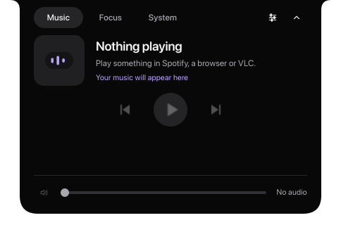

# Kestrel Island

A small Dynamic Island / simulated notch for **KDE Plasma on Linux**. Inspired by the island feature in [Vorssaint](https://github.com/vorssaint/vorssaint-utils); independently implemented, with its own name and artwork. This project implements the island only.



## What works

- Compact music/video activity shows the current local artwork thumbnail, with the island icon as fallback when artwork is missing or unreadable.
- A black notch anchored at the top center of your chosen monitor, with animated expansion and concave shoulders.
- Starts as a 288×40 notch. Hover to expand; move away to collapse after a short 180 ms grace period. Only the top Pin button keeps the island open. Clicking controls or changing tabs never pins it. Click the up arrow or press Escape to collapse explicitly; hover stays closed until you leave and enter again. Hover expansion is enabled by default and can be disabled in Settings.
- The settings icon is visible even when compact. It opens an in-island settings page with the actual display names, top offset, and optional hover expansion. The right-click/tray menu remains available.
- Drag the compact title onto another display and release anywhere on that display to move the notch. Temporary drop targets appear during the drag; Escape cancels. The notch remains anchored at the top center of the destination display.
- **Music:** title, artist, local artwork, play/pause, previous/next, and a capability-aware scrub timeline through MPRIS, with automatic selection of the current playback source. Works with players that expose MPRIS, including supported browsers, Spotify and VLC. Controls follow each player's advertised capabilities. The most recently started or changed playing source wins; Plasma Browser Integration is preferred when equivalent sources tie. There is no player dropdown.
- **Focus:** selectable countdown/Pomodoro modes, editable minutes and 25/50-minute presets, work/rest phases, pause/resume/cancel, remaining time in the compact notch, and completion held until dismissal. Next phases start only when requested.
- **System:** live CPU load/history, model, cores, frequency and temperature; RAM used/total/available and swap; per-GPU load, VRAM and supported temperature/power readings; disk used/total/free. CPU/RAM sample every second while expanded, GPU every two seconds, disk every ten seconds. NVIDIA uses optional `nvidia-smi`; AMD uses kernel sysfs. Unsupported counters say unavailable.
- **Audio:** default output volume and mute through PipeWire's PulseAudio compatibility service or PulseAudio; optional compact feedback and confirmed default microphone mute with a persistent muted icon.
- **Keep awake:** timed screen/sleep inhibition with explicit confirmation and automatic release.
- **Task hooks:** optional running/attention/completed/failed activity via the local command wrapper; no provider log reading.
- **Notifications:** a KDE watcher implementation with an opt-in allowlist and memory-only inbox. Live reception remains unavailable until the real lock/DND privacy gate is validated; mocks alone do not enable it.
- Per-monitor selection, top offset to clear a KDE panel, optional hover expansion, reduced motion and opt-in startup at login.

Built with C++20, Qt 6 Quick and KDE LayerShellQt. On Wayland this is a real layer surface, not an ordinary window hoping the compositor honors its position. It reserves no workspace area. On KDE Wayland, active fullscreen games and videos are stacked above the notch; returning to the desktop reveals it again. A shape mask lets clicks outside the notch reach the windows underneath. Keyboard focus is on demand, not exclusive. An X11 positioning fallback is implemented but has not been tested on a live X11 desktop.

Open **Tools** for Keep awake, Tasks and Inbox. The island remembers the page you choose when reopening on hover. Enable audio feedback or task hooks explicitly. See [task hook setup](docs/INTEGRATIONS.md).

## Build and run

On CachyOS / Arch:

```sh
sudo pacman -S --needed base-devel cmake ninja qt6-base qt6-declarative layer-shell-qt libpulse
cmake -S . -B build -G Ninja -DCMAKE_BUILD_TYPE=Release
cmake --build build -j 4
./build/kestrel-island
```

Requirements: Qt ≥ 6.6, CMake ≥ 3.22, a C++20 compiler, LayerShellQt. Other distributions need the corresponding development packages. KDE Plasma Wayland is the primary target. PulseAudio's `pactl` command is optional; music and timers work without it.

Install for your user, including the application-menu entry:

```sh
cmake --install build --prefix "$HOME/.local"
```

Launch **Kestrel Island** from KDE's application menu. If `~/.local/bin` is not in your PATH, run `~/.local/bin/kestrel-island` directly. Running a second instance toggles the existing island.

Click the compact **Settings** icon → **Display** to choose a monitor, or drag the compact title to the other display. **Top offset** clears a top panel. On this machine, **DP-2** is the large 5120×1440 display and **DP-1** is the portrait display. Right-click → **Start at login** to opt in; it is off by default. To stop, choose **Quit Kestrel Island** in the tray menu.

## Tests and previews

```sh
ctest --test-dir build --output-on-failure
./build/kestrel-island --check-session
./build/kestrel-island --check-session --cycle-displays
QT_QPA_PLATFORM=offscreen QT_QUICK_BACKEND=software ./build/kestrel-island --screenshot /tmp/kestrel-preview --expanded
```

The test suite covers metadata parsing, capabilities, timer validation, pause/resume, actual QML click/hover/settings/icon behavior, audio-slider regressions, and an actual MPRIS round trip on an isolated session bus when `dbus-run-session` is available. `--check-session` briefly opens the island on your actual desktop, reports exposure, input mask, live system/audio availability as JSON, and exits. Add `--cycle-displays` to remap between displays and restore the selected display. Quit any running instance first. Screenshot mode uses an offline empty media state and does not show your media titles or change settings. `--page system` reads aggregate hardware counters for its preview.

## Data and boundaries

No account, telemetry, network requests, root helper, or shell execution. Settings are stored by QSettings under `~/.config/Kestrel/`. Optional startup creates `~/.config/autostart/io.github.kestrel.Island.desktop`. The focus timer is in memory and stops when the app exits. It is a desktop convenience timer, not an alarm intended to wake a suspended system.

Remote album artwork is deliberately not downloaded; local `file://` artwork is shown, with the island icon as fallback. The animated bars indicate playback and are not an audio spectrum analyzer. Calendars, camera previews, downloads and the rest of Vorssaint's toolkit remain outside scope. Standard Plasma notifications remain managed by Plasma. See [implementation status and remaining manual gates](docs/IMPLEMENTATION.md).

To uninstall, first disable **Start at login** and quit the app, then remove the three files listed in `build/install_manifest.txt`. Settings can optionally be removed from `~/.config/Kestrel/`.

## License and provenance

GPL-3.0-or-later. The implementation and SVG assets here were written for this project. No upstream Swift source, branding or assets were copied. See [docs/ARCHITECTURE.md](docs/ARCHITECTURE.md) for integration references.

Explicit native integration checks and their limits are documented in [LIVE_CHECKS.md](docs/LIVE_CHECKS.md). Version 0.3.1 improves Focus, Music, Keep awake and Tasks; child pages have a Back to tools control. These checks do not certify an actual Dota 2 match or physical cable hotplug.
